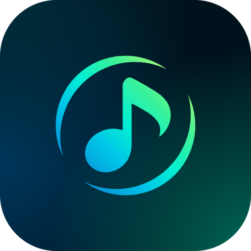
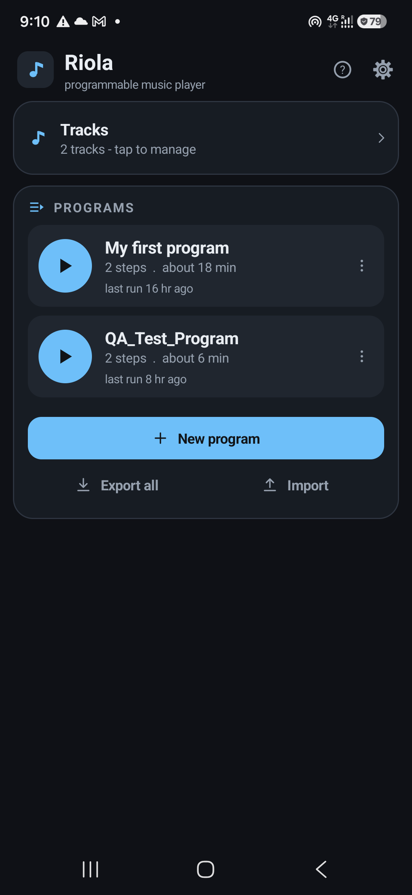
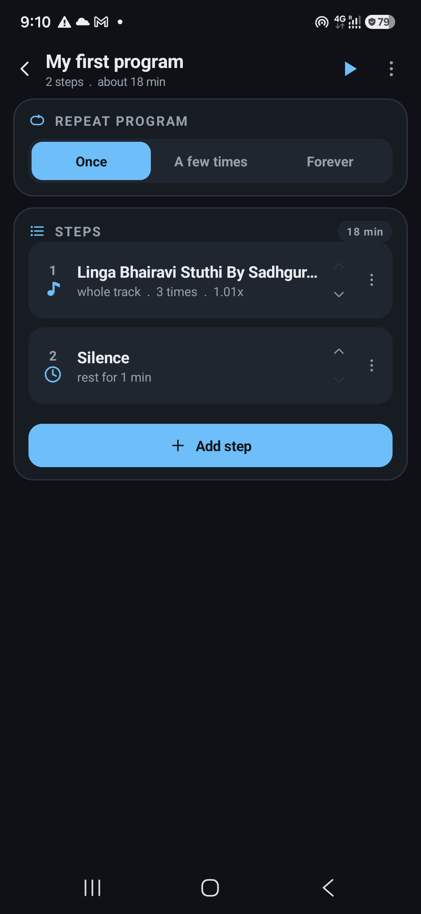
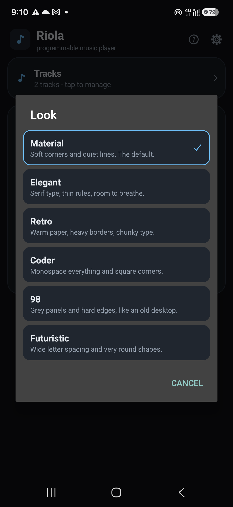

<p align="center"></p>

# Riola

A programmable music player for Android. Add some tracks, then build a program
by tapping: play this whole track, loop that 40-second section eight times with
a three-second rest between each, sit in silence for two minutes, repeat the
whole thing four times.

Built for practice loops, sleep and meditation sequences, interval training,
ear training — anything where "play this bit for ten minutes, rest two, then
the whole thing twice" is easier to set up once than to babysit.

There is no scripting language and nothing to type. Every part of a program is
a tap.

| | | |
|---|---|---|
|  |  |  |


## Building

Plain Java against `android.jar`: no Gradle, no AndroidX, no third-party
libraries. `build.sh` drives `aapt2`, `javac`, `d8`, `zipalign` and `apksigner`
and writes a signed APK to `build/riola.apk`.

```bash
./build.sh              # build/riola.apk, signed with your debug key
./build.sh --install    # build, then adb install -r
./build.sh --clean      # wipe build/ first
```

Requirements, on Ubuntu or any Linux:

- a JDK 17 or newer: `sudo apt install openjdk-17-jdk-headless`
- the Android SDK build-tools (33+) and one platform (`android-34` or newer).
  `build.sh` looks in `$ANDROID_HOME` (default `~/Android/Sdk`). If your tools
  live elsewhere, point `BUILD_TOOLS` at the folder holding `aapt2` and `d8`,
  and `ANDROID_JAR` at an `android.jar`.
- `adb` and a phone with USB debugging, for `--install`

A debug keystore is created at `~/.android/debug.keystore` if you have none.
Everything under `build/` is generated and git-ignored; the source is `app/`.

## How a program is built

**Home** lists your saved programs, each with a play button. Tap a program to
edit it, tap play to run it.

**A program** is an ordered list of steps plus a repeat count for the whole
list (once, a few times, or forever).

**A step** is one of four things:

| Step | What it does |
| --- | --- |
| Whole track | plays a track start to finish |
| Section | plays one A-B slice of a track |
| Silence | plays nothing (and can end with a bell) |
| Bell | a soft chime to mark a change |

Every playing step repeats either **a number of times** or **for a length of
time**, and can carry a gap between repeats, its own speed, its own volume, and
an on/off switch so you can park a step without deleting it.

**The bell** ships as four short wav files in `app/res/raw/`, so a ring never
waits on any maths. They were made by `tools/gen-bells.sh` from a formula in
`Bell.java` (the app falls back to that formula if a file cannot be read), and
cost about 1.4 MB of the APK. Six partials over a fundamental, where the bright
ones decay in under a second and the low ones ring on for four to six, an 8 ms
ramped attack so there is no click, and a second prime a hair sharp for a slow
shimmer. Four voices (low, warm, bright, desk), one to nine rings with a gap you
choose. A bell at the end of a silence rings out in full before the next step
starts, unless that step is more silence. It is built to mark a moment without
jolting you — which matters when the whole point is that your eyes are closed.

**Sections** can be typed as minutes and seconds, or marked by ear: play the
track, tap *Set A* and *Set B*, nudge each mark by a second, and loop the slice
while you fine-tune it.

## What else it does

- **Library** — add files or scan a whole folder. Storage Access Framework, so
  no storage permission, and the grants survive reboots. Durations are read in
  the background; tracks can be renamed, reordered and previewed.
- **Video files work too** — Riola plays their sound and never asks for the
  picture. Where a file carries several audio streams, a dubbed film say, you
  can pick which one that track uses.
- **Colour and Look** — the palette is derived from one accent colour: eight
  presets or mix your own. Six looks change shape rather than just shade —
  Material, Elegant, Retro, Coder, 98 and Futuristic each drive corner radius,
  border weight, typeface, spacing and icon line weight. Both are independent
  of dark mode and of each other.
- **Export and import** — a program, or all of them, written to a file you
  choose and read back later. Import treats the file as untrusted and reports
  exactly what it added and what it skipped.
- **Steps reference the track itself**, not its position, so reordering or
  renaming the library never breaks a program. Remove a track a program uses
  and the step is flagged *missing* and skipped rather than stopping the run.
- **Background playback** — a foreground service with notification and lock
  screen transport, MediaSession, audio focus handling (pauses for calls, ducks
  for notifications), pause on headphone unplug, and an optional CPU wake lock
  so long silences stay exact.
- **While running** — pause/resume, previous/next step, tap any step to jump to
  it, scrub inside the current track, and see time left in the step and in the
  whole program. The editor scrolls itself to keep the playing step in view.
- **Full screen player** — tap the transport strip for large controls you can
  find without looking, the time in big figures, and a moon button that dims
  the screen to near black for a dark room.
- **Missing files are caught before playback**, not twenty minutes into a
  session: Riola opens every track a program needs first and names the steps
  that cannot play.
- **Settings** — dark/light, keep screen on, master volume and speed, loop-edge
  fade, a count-in before the first step, and a stop-after timer.

No network permission, no accounts, no analytics. Nothing leaves the phone.

## Layout of the code (`app/src/com/riola/player/`)

| File | What it does |
| --- | --- |
| `MainActivity` | home: saved programs, live step list, settings |
| `EditorActivity` | the tap-to-build program editor |
| `NowPlayingActivity` | the full screen player |
| `Bell` | the chime: loads the bell wav files, or synthesises them |
| `Runner` | pre-play checks, then hands the program to the engine |
| `LibraryActivity` | the track library |
| `StepSheet` | the editor for one step |
| `AbDialog` | mark a section by ear |
| `Pickers` | track / length / position / name dialogs |
| `PlayerBar` | the shared transport strip |
| `Engine` | worker thread + one `MediaPlayer`, runs the step list |
| `PlayerService` | foreground service, notification, MediaSession, audio focus |
| `Program` / `Step` | the data model |
| `Store` / `Prefs` | persistence (SharedPreferences + JSON) |
| `Ui` / `Ico` | palette, widget factory, hand-drawn vector icons |
| `Fmt` / `HelpText` | formatting and the in-app guide |
| `Themes` | the colour and look pickers |
| `Backup` | export and import |
| `Track` / `TrackPicker` | a library track, and the multi-select track picker |

Resources and the manifest are in `app/res/` and `app/AndroidManifest.xml`.

Min SDK 26 (Android 8.0). The build targets the newest platform installed in
your SDK. Developed and tested on a Galaxy A55 (Android 16) and a Xiaomi
2302EPCC4I (Android 13).

## The logo

A music note inside a ring that is broken into two crescents. The ring is exact
geometry (one outer circle, two mirrored crescents), the note is traced from the
original artwork with its stem made truly vertical, and the colour runs from
azure through aqua to mint.

It is vector art, so there are no icon PNGs in the app: the launcher icon is an
adaptive icon (`ic_launcher_bg`, `ic_launcher_fg` and a one-colour
`ic_launcher_mono` for themed icons) and the notification icon is the one-colour
mark. Inside the app the home screen header paints the same shapes in code
(`LogoDrawable`, from the generated `LogoPaths`) with a gradient built from the
accent colour the user picked and a tile that takes the current look's corners,
so it follows the theme. The launcher icon, which nothing can theme, keeps the
fixed azure-to-mint. `docs/icon-512.png` is the Play store icon.

To change it, edit the numbers at the top of `tools/logo/design.py` (ring size,
thickness, gap) or the colours in `tools/logo/render.py`, then run
`python3 tools/logo/export_android.py .` (needs `numpy` and `pillow`). That
rewrites the drawables, `LogoPaths.java` and the two PNGs. `tools/logo/trace_note.py` is how the
note was first traced from a reference image.

## Publishing

- [RELEASING.md](RELEASING.md) — upload key, target API, signed builds, and
  what Google Play asks for.
- [PRIVACY.md](PRIVACY.md) — short, because Riola has no internet permission
  and collects nothing.
- [LICENSE](LICENSE) — MIT.
